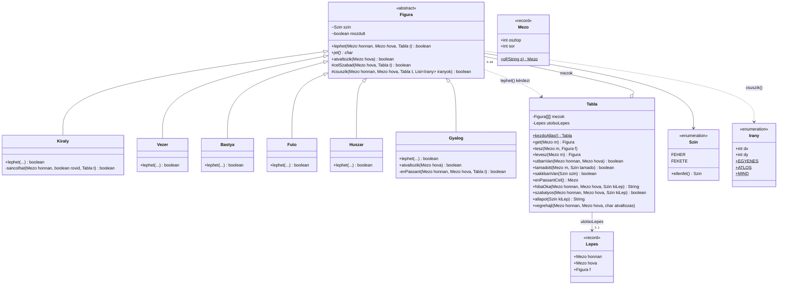

# Sakk bíró

Konzolos sakklépés-ellenőrző Java 25-ben. Nem sakkmotor: egy állásból és egy lépésből
(pl. `e2 e4`) eldönti, hogy a lépés szabályos-e, és ha nem, miért.

## Futtatás

```
mvn compile
java -cp target/classes sakk.Main
mvn test
```

Vagy IntelliJ-ből: `sakk.Main` futtatása, a tesztekhez a `src/test/java` mappán *Run 'All Tests'*.

- Lépés formátuma: `e2 e4`, kilépés: `q`.
- Gyalog beérésekor a program megkérdezi, mivé változzon (`V`/`B`/`F`/`H`, alapból vezér).
- Ha a Windows-konzolon `?` jelenik meg a figurák helyén, előbb: `chcp 65001`.

## Támogatott szabályok

- Minden figura alaplépései: király, vezér, bástya, futó, huszár, gyalog.
- Ütés; saját figura nem üthető; csúszó figurák útját nem zárhatja el semmi.
- Gyalog: egy lépés előre, kettő a kezdősorból (ha üres az út), átlós ütés.
- **Saját sakk tilalma**: kötött figura nem léphet el, a király nem léphet támadott mezőre,
  és a sakkot hárítani kell.
- **Sáncolás** (rövid és hosszú): a király és a bástya nem mozdult, köztük üres a sor,
  a király nincs sakkban, és nem halad át / nem érkezik támadott mezőre.
- **En passant**: csak közvetlenül az ellenfél kettős gyaloglépése után; az ütött gyalog lekerül.
- **Átváltozás**: választható vezér/bástya/futó/huszár, alapból vezér.
- Felváltva lépés; minden lépés után `sakk`, `matt` vagy `patt` kiírása. Matt és patt
  esetén a játszma véget ér.

## Ismert korlátok

- Nincs döntetlen szabály: 50 lépéses szabály, háromszori ismétlés, anyaghiány.
- Nincs feladás, döntetlenajánlat, visszalépés (undo).
- Csak koordinátás bemenet (`e2 e4`), algebrai jelölés (`Nf3`, `O-O`) nem.
  Sáncolás: a király két mezős lépésével (`e1 g1`).
- Nincs FEN-betöltés: a játék mindig a kezdőállásból indul (tesztekben kézzel rakható össze állás).
- A `Tabla.tamadott()` a gyalog átlós támadását csak foglalt mezőre látja (mert a gyalog
  `lephet()`-je ütést kér). Ahol ez számít (sáncolásnál az átlépett mező), a program a
  királyt ténylegesen odahelyezi egy másolaton, így a szabály helyesen működik.
- A matt/patt vizsgálat nyers erővel próbál ki minden lépést (64×64); 8×8-as táblán ez gyors.

## Felépítés

| Osztály | Feladat |
|---|---|
| `Szin`, `Mezo`, `Irany`, `Lepes` | Egyszerű értéktípusok (szín, mező, irány, utolsó lépés). |
| `Figura` | Absztrakt ős: `lephet()` és `jel()`; közös segédek: `csuszik()`, `celSzabad()`. |
| `Bastya`, `Futo`, `Vezer` | Csúszó figurák: csak az irány-listájukat adják át a `csuszik()`-nak. |
| `Kiraly`, `Huszar`, `Gyalog` | Saját geometria; a király a sáncolást, a gyalog az en passant-t is felismeri. |
| `Tabla` | Az állás. Kérdésekre válaszol (`utbanVan`, `tamadott`, `sakkbanVan`, `enPassantCel`), ellenőriz (`hibaOka`/`szabalyos`, `allapot`) és végrehajt (`vegrehajt`). |
| `TablaNezet`, `Main` | Kirajzolás és a beolvasó ciklus. |

### Osztálydiagram



Nincs `switch` a figura típusára a lépéslogikában: a `Tabla` minden figurától a saját
`lephet()`-jével kérdezi meg, léphet-e. Így működik a `tamadott()` is: egy mező akkor
támadott, ha valamelyik ellenséges figura `lephet()`-je oda igent mond.

Egy lépés ellenőrzése (`Tabla.hibaOka`) három lépcsős:
1. van-e saját figura a kiinduló mezőn,
2. a figura `lephet()`-je igaz-e (pszeudo-szabályosság),
3. a lépést egy **másolaton** végrehajtva nem kerül-e sakkba a saját király
   (ez fedi le a kötést, a támadott mezőre lépést és a sakk hárításának elmulasztását).

Sáncolásnál ezen felül: a király nem lehet sakkban, és nem haladhat át támadott mezőn.

## Tesztek

JUnit 5, `src/test/java/sakk`:

- `MezoTest`: algebrai jelölés beolvasása, hibás bemenetek (paraméterezett).
- `FiguraTest`: minden figurára szabályos és szabálytalan lépések üres táblán
  (paraméterezett), elzárt út, saját figura ütése, a `lephet()` mellékhatás-mentessége.
- `TablaTest`: saját sakk tilalma (kötés, támadott mezőre lépés, sakk hárítása), sáncolás
  (megengedett és 6 tiltott eset), en passant, átváltozás, sakk/matt/patt.

## LSP: belefér-e a gyalog különleges szabályai az ős szerződésébe?

**Igen.** A `Figura.lephet()` szerződése: tiszta függvény, csak pszeudo-szabályosságot
vizsgál, a saját sakk nem az ő dolga. A gyalog minden különlegessége ezen belül marad:

- **Szín szerinti irány, kettős lépés, átlós ütés**: csak geometria, a táblából olvasva.
- **En passant**: a gyalog a `Tabla.enPassantCel()`-t kérdezi meg. Ez csak olvasás; az
  en passant mező a sakkszabályok szerint az állás része (a FEN is tárolja), tehát a
  `lephet()` továbbra is „az adott állásban” válaszol. Az ütött gyalogot a `Tabla` veszi le
  végrehajtáskor.
- **Átváltozás**: nem a `lephet()` része, hanem a lépés következménye. A gyalog csak
  felülírja az `atvaltozik()` metódust (alapból `false`), a cserét a `Tabla` végzi, a
  választást a játékmenet kérdezi meg.

A hívók (`tamadott`, `hibaOka`) semmit sem tudnak arról, hogy épp gyalogot kérdeznek, és
nem kell semmi extrát tenniük érte: bármely `Figura` behelyettesíthető. A szerződést az
sértené meg, ha a `lephet()` módosítaná a táblát vagy a figurát, vagy ha a hívónak a
gyalogot külön kellene kezelnie.

Az `instanceof` csak a király megtalálására és a különleges lépések (sáncolás,
gyalog kettős lépése / en passant) felismerésére szerepel a `Tabla`-ban, lépéslogikára nem.
